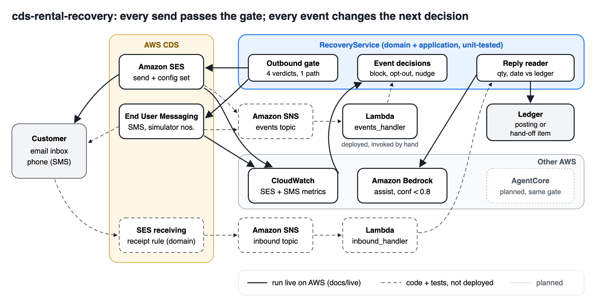
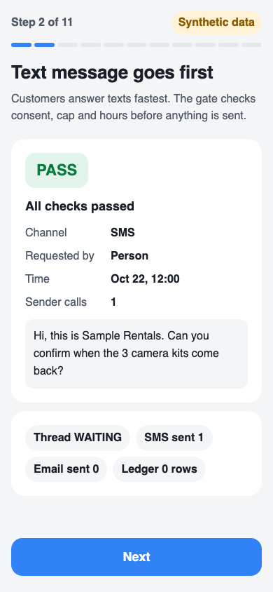
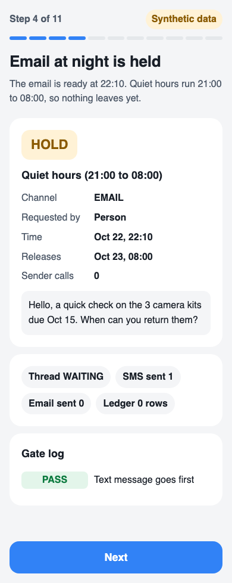
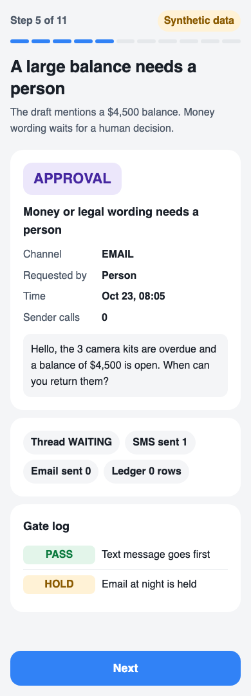
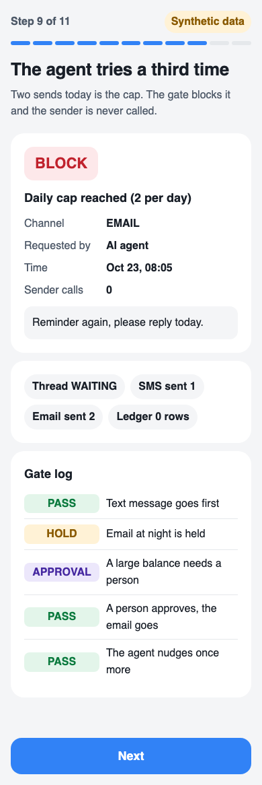

# Rental Recovery: an end-to-end agentic workflow on SES and SMS that stops before it over-sends

A small equipment-rental shop chases every overdue item by hand: a text or email asking "when will you bring it back?", then a ledger update. This repo runs that conversation end to end on AWS Communication Developer Services (Amazon SES and End User Messaging SMS): open the overdue item, send through an outbound gate (PASS, HOLD, BLOCK or APPROVAL, shown before every send, human or agent), read the reply into quantity and date, check it against the ledger, then post it and close, or hand it to a person with a reason. Delivery, bounce and opt-out events change the next decision.
Value is stated as a formula with its lower bound: `N × c × m / 60 × w − N × s × p` ([docs/ROI.md](docs/ROI.md)); base case 23,578 KRW (about $17) per month for 40 overdue items at minimum wage, low case below zero.

**Try it in 3 minutes, no AWS account, no login, no install:** `python3 -m infrastructure.web` then open http://127.0.0.1:8765 (Python 3.9+, standard library only). At step 10 type your own customer reply; the reader and ledger check run on your text. All data on the screen is synthetic. Example: "We will drop off all 3 tomorrow morning" reads as 3 units, next day, matches the ledger ([screenshot](docs/screens/try-your-reply.png), fresh browser, no login).

## How this differs from what already exists

Read from each product's public page on 2026-10-26. "Not shown" means we did not see it there, not that it cannot be done.

| Product | What it does for this job | What we add |
|---|---|---|
| [AWS sample: AI campaign orchestrator](https://github.com/aws-samples/sample-ai-campaign-orchestrator) (Bedrock + End User Messaging) | Picks a channel per customer, holds sends to fatigued or unhappy customers (count over a window, sentiment threshold) | A per-message verdict with four policies (opt-out, quiet hours, daily cap, approval) on a one-to-one conversation, and the reply read back into a ledger |
| [AWS sample: SES Mail Manager attachment pipeline](https://github.com/aws-samples/sample-amazon-ses-mail-manager-attachment-pipeline) | Inbound email classified by Bedrock; machine-readable deployment guide for agents | The outbound side and the loop: send, event, reply, ledger post or hand-off; our own agent guide in [AGENTS.md](AGENTS.md) |
| [AWS sample: RCS agent setup](https://github.com/aws-samples/sample-rcs-agent-setup-and-send-messages) | AGENTS.md skills that set up an RCS agent and send messages | A business conversation that ends in a state change (CLOSED or HANDOFF), not channel setup |
| [Booqable](https://booqable.com/features/) (rental software) | Marks late returns in a dashboard; email reminder templates | Not shown: reading the customer's answer and checking it against the ledger |
| [EZRentOut](https://www.ezrentout.com/) (rental software) | One view of what is out, due back or overdue | Not shown: two-way messaging with a send gate |
| [Chaser](https://www.chaserhq.com/) (invoice chasing) | Email and SMS payment reminders, AI email generator | Built for invoices, not equipment returns; not shown: event-driven stop after bounce or opt-out |

**Only here:** every send, including one an AI agent proposes, shows its gate verdict before it leaves, and SES/SMS events and the customer's reply change the next decision instead of a fixed reminder schedule.

## What is real and what is simulated

| Part | Status | Evidence |
|---|---|---|
| SES sends through the gate (4) and DELIVERY, BOUNCE, OPT_OUT events read back | Real, us-east-1 sandbox, mailbox simulator and owner inbox only | `docs/live/live-log.jsonl`, `docs/live/EXCERPT.md` |
| Customer reply read into quantity and date, posted, thread CLOSED | Reading is real; the reply travelled by the owner's Gmail, not SES receiving | live-log lines 18-19 |
| SES receiving, SNS, Lambda (`template.yaml`) | Code, unit tests, `cfn-lint` pass; not deployed (author's IAM user lacks CloudFormation) | `tests/test_lambda_handlers.py`, [AGENTS.md](AGENTS.md) |
| End User Messaging SMS send and events | Adapter and parsers unit-tested; no live SMS sent | `tests/test_adapters.py` |
| AI agent | A scripted agent stands in for AgentCore; it goes through the same gate | `test_g11_no_path_to_sender_except_gate` |
| Screen | Synthetic data, labelled on every screen | `docs/screens/` |



## Gate verdicts on screen (390 px)

| PASS | HOLD | APPROVAL | BLOCK |
|---|---|---|---|
|  |  |  |  |

Failure handling, one row per failure type with its test: [docs/FAILURES.md](docs/FAILURES.md). Judging criteria to evidence: [docs/JUDGING.md](docs/JUDGING.md). Offering and pricing: [docs/OFFERING.md](docs/OFFERING.md). Sources for every AWS fact quoted here: [docs/SOURCES.md](docs/SOURCES.md).

## Run

```
python3 -m venv .venv && .venv/bin/pip install pytest boto3
.venv/bin/pytest -q && .venv/bin/python tools/check_readme.py
.venv/bin/python -m infrastructure.web   # open http://127.0.0.1:8765
```

Tests: <!--tests-->107<!--/tests--> passing (`tools/check_readme.py` fails if this number drifts).

## Layers (no reverse imports, enforced by `tests/test_layers.py`)

`domain/` gate policies, reply reading, thread states, event decisions. `application/` use cases and ports.
`adapters/` SES send/inbound/events, End User Messaging SMS, in-memory fakes. `infrastructure/` boto3 client factory (no calls), demo story, web screen.

## Gate screen

Eleven steps: text, bounce, held email, approval, delivery, agent nudge, daily-cap block, reply reading, ledger row.
A second case shows opt-out. Screens at 390px are in `docs/screens/` (`python tools/capture.py` regenerates them and checks for horizontal scroll and text under 16px).

## Live SES run (2026-10-26, us-east-1, sandbox account)

Log: `docs/live/live-log.jsonl` (excerpt `docs/live/EXCERPT.md`). Four gated sends through `RecoveryService` + `SesEmailSender` (all PASS): owner inbox, `success@`, `bounce@`, `complaint@simulator.amazonses.com`.
Events read back from the CloudWatch destination of the SES configuration set, then fed to `handle_event`:

| case | event | decision | same send retried |
|---|---|---|---|
| success@ | DELIVERY | delivered, nudge timer | PASS (SES called) |
| bounce@ | BOUNCE | address blocked, no other channel, hand-off | BLOCK address_blocked, SES calls 0 |
| complaint@ | DELIVERY + OPT_OUT | customer opted out, hand-off | BLOCK opt_out, SES calls 0 |

Limits measured on this account (`get_account`): 200 sends per 24 h, 1 send per second (sandbox); only verified addresses and the simulator can receive. Failure path: BOUNCE and OPT_OUT end in a hand-off item, never a silent retry.

Reply leg: a reply typed into the owner's inbox ("I'll bring back 3 on Thursday") was read back and parsed: qty 3, 2026-10-29, confidence 0.9, matches ledger, posted, thread CLOSED.
Not real: SES did not receive that reply. SES inbound needs a verified domain with an MX record, which this account does not have (buying one is a cost decision). The reply therefore travelled by Gmail, not SES receiving. The send from the owner's own Gmail address to itself was reported Delivered by SES but never appeared in Gmail (forged-sender drop), so the S1 round trip is partial.

## Reply variants (k = 14, synthetic, `python3 -m infrastructure.variant_eval`)

Same recovery conversation, 14 customer replies (8 clean in English/Korean/ISO/abbreviations, 6 that must go to a human). Labels were written before the run.
Closed 8 of 14 (57%); all 8 expected-closed reached CLOSED; the 6 others handed off at the first reply (hand-off turn 1); auto-closed against the label 0; send after opt-out BLOCK with 0 provider calls; policy violations 0. The reader is regex-based, so this measures the gate and hand-off rules, not language understanding.

## Not done yet

SES receiving on a verified domain, a live End User Messaging SMS send, a CloudFormation deploy by the author, an AgentCore agent. See SPEC.md S1, S3, S5.

## Pre-existing work and license

All code in this repo was written from 2026-10-22 (first commit 2026-10-22). No pre-existing code is included. The idea of a send gate comes from the author's earlier private experience of an agent over-sending; no code from it is used. License: MIT ([LICENSE](LICENSE)).
